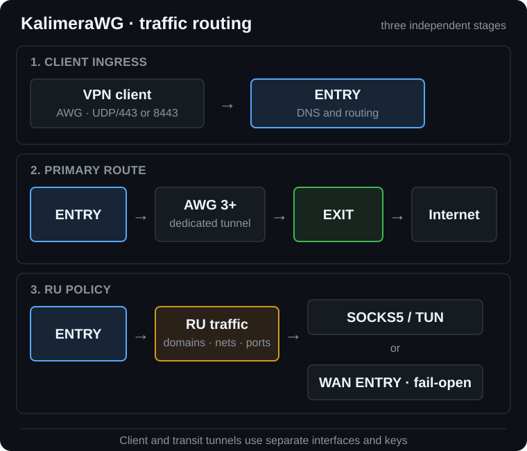
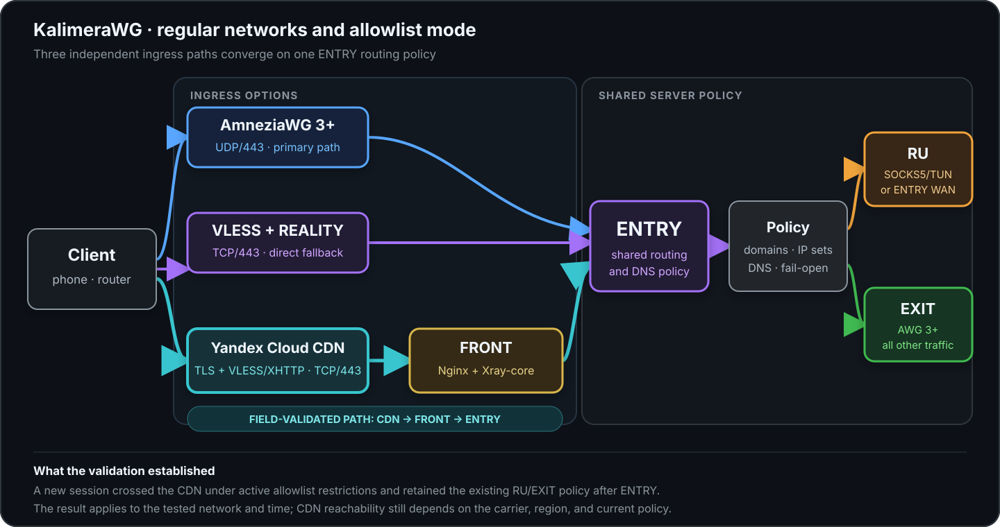

<p align="center">
  <a href="README.md">Русский</a> ·
  <a href="README.en.md"><b>English</b></a>
</p>

<p align="center">
  
</p>

<h1 align="center">KalimeraWG</h1>

<p align="center">
  <b>Your own AmneziaWG 3.1 VPN cascade in one command.</b><br>
  Enter in your own country, exit abroad, keep local sites direct,<br>
  and keep a CDN fallback for allowlist-only networks.
</p>

<p align="center">
  <a href="https://github.com/FujitaKinzoku/KalimeraWG/releases/latest"></a>
  <a href="https://github.com/FujitaKinzoku/KalimeraWG/actions"></a>
  
  
  
  <a href="LICENSE"></a>
</p>

<p align="center">
  <a href="#quick-start">Quick start</a> ·
  <a href="#features">Features</a> ·
  <a href="#how-it-works">How it works</a> ·
  <a href="#day-to-day-use">Commands</a> ·
  <a href="#documentation">Documentation</a> ·
  <a href="CHANGELOG.md">What's new</a>
</p>

---

KalimeraWG turns two or three clean Ubuntu 24.04 VPS into a ready-to-use VPN
cascade. You answer the installer's questions, and 20–40 minutes later you have
working servers, a first client and a set of commands for everyday operation.
No hand-editing of configs, `iptables` or `systemd`.

**Why a cascade.** The client connects to an ENTRY server in its own country:
such connections are blocked less often and are faster. From there, traffic
travels through a dedicated tunnel to an EXIT server abroad, and websites see
the EXIT address. Russian sites still open directly from ENTRY, as if the VPN
were off. If AmneziaWG gets blocked or the network switches to allowlist mode,
a third server, FRONT, accepts VLESS through a Russian cloud CDN.

## Features

- **ENTRY → EXIT cascade.** A dedicated AmneziaWG 3.1 tunnel between the
  servers, running on the kernel module with its own keys and parameters. The
  EXIT port is open to the ENTRY address only.
- **AmneziaWG 3.1 obfuscation.** The full set of obfuscation fields, with a
  profile structure generated anew for every installation.
- **CDN fallback.** FRONT accepts VLESS/XHTTP directly or through a CDN and
  forwards traffic to ENTRY over an internal REALITY hop, so CDN clients never
  see the ENTRY address. Verified with Yandex Cloud CDN and VK Cloud CDN.
- **Country-aware routing.** Russian networks and domains go directly from
  ENTRY or through your SOCKS5 proxy (for example, SOAX); everything else goes
  through EXIT. If the proxy fails, traffic falls back to the direct route.
- **Leak-free DNS.** Clients use a local Unbound resolver on ENTRY; upstream
  queries leave over DoT or DoH. DNSSEC recursion on EXIT inside the tunnel is
  available as an option.
- **Profiles for every client.** `performance`, `balanced`, `masking`,
  `mobile/AWG3+` for AmneziaWG 5, and a compatibility profile for KeeneticOS 4.3.
- **Automatic MTU.** The installer measures path MTU in both directions and
  negotiates the MTU of every segment, client configs included.
- **No plaintext secrets on disk.** Shamir 2-of-N plus AES-256-GCM: plaintext
  configuration lives in RAM only and services receive it via systemd
  credentials. A stolen disk from one server reveals nothing.
- **No logs.** journald, Fail2Ban and login accounting live in RAM only. UFW
  and DNS query logs, shell history and core dumps are disabled.
- **Locked-down SSH.** A dedicated `kalimera` admin, key-only login, root
  disabled, a non-standard port and Fail2Ban.
- **Self-monitoring.** `awg-health` and `server-audit` check services,
  firewall, DNS and routes. Telegram reports reboots and failures.
- **Updates under control.** Every server checks daily for a new kernel,
  AmneziaWG and Xray-core and shows `UPD` with the command that applies it.
  An update is one command, verified and rolled back on failure.

### What KalimeraWG does not do

- It does not promise anonymity or protection from targeted surveillance.
- It does not guarantee bypassing every block. Operators can change policy at
  any time, and FRONT is an emergency path, not a universal solution.
- It does not install a web panel or open extra ports. Management is SSH only.
- It does not keep browsing logs or put client configs into Git or CI.
- It does not update itself. It reports new versions but installs them only
  on your command.

## How it works

<p align="center">
  <picture>
    <source media="(max-width: 600px)" srcset="assets/cascade-en-mobile.svg">
    
  </picture>
</p>

| Path | Transport | When it is used |
|---|---|---|
| client → ENTRY | AmneziaWG 3.1, UDP/443; mobile/AWG3+ on UDP/8443 | primary path, lowest overhead |
| client → FRONT | TLS + VLESS/XHTTP, TCP/443 | AmneziaWG is blocked by its UDP fingerprint |
| client → CDN → FRONT | TLS + VLESS/XHTTP, TCP/443 | allowlist mode while a cloud CDN is reachable |
| FRONT → ENTRY | VLESS + REALITY | internal hop that hides ENTRY from CDN clients |
| ENTRY → EXIT | AmneziaWG 3.1 on the kernel module | all foreign traffic |
| ENTRY → RU | direct or through SOCKS5 | Russian networks and domains |

### Allowlist mode

<p align="center">
  <picture>
    <source media="(max-width: 600px)" srcset="assets/whitelist-cascade-en-mobile.svg">
    
  </picture>
</p>

A field test confirmed that with allowlist mode active, a new session comes up
through **Russian cloud CDN → FRONT → ENTRY**, and after that Russian traffic
still goes direct while the rest leaves through EXIT. The result applies to the
networks, CDN and moment tested and does not guarantee identical behaviour on
every carrier.

Client-to-server data travels in the headers of GET requests without a request
body: since 30.09.2026 Yandex Cloud CDN answers `413` to a GET with a body. As
a result, upload through the CDN is limited to about 2.2 Mbit/s; download is not
limited. Details, CDN settings and the failure matrix are in
[docs/front-relay.md](docs/front-relay.md).

## Quick start

### 1. Prepare the servers

| | Requirement |
|---|---|
| **ENTRY** | a VPS in your country with a public IPv4. The installer runs here |
| **EXIT** | a VPS abroad with a public IPv4 |
| **FRONT** | optional: a VPS with a public IPv4 and a domain whose A record points to it |
| **OS** | clean Ubuntu 24.04 LTS on every server |
| **Access** | to EXIT and FRONT: SSH login **with a password** as root or as a user with `sudo` |
| **Time** | 20–40 minutes |

The installer puts its own key on EXIT and FRONT through password login and, at
the end, disables both root login and passwords itself. ENTRY needs no
password: the installer runs there locally as root.

<details>
<summary><b>The server only has a key-based user without a password (common on clouds)</b></summary>

Temporarily allow root password login. As your user, run:

```bash
sudo passwd root
printf 'PermitRootLogin yes\nPasswordAuthentication yes\n' | sudo tee /etc/ssh/sshd_config.d/01-bootstrap.conf
sudo sshd -t && sudo systemctl restart ssh
```

Keep the session open and check `ssh root@IP` with the password from another
computer. After installation, remove the temporary file:

```bash
sudo rm /etc/ssh/sshd_config.d/01-bootstrap.conf && sudo systemctl restart ssh
```

By then the installer's settings already take precedence over this file.

</details>

### 2. Prepare the CDN (FRONT through a CDN only)

1. The A record of the origin domain, for example `example.com`, points to FRONT.
2. CDN resource: HTTPS origin on that domain, Host header and SNI equal to the
   origin domain, caching off, GET allowed.
3. The public CDN domain, for example `cdn.example.com`, is set up in DNS as
   your CDN provider instructs.

### 3. Run the installer

On ENTRY as root (`sudo -i` if you logged in as a regular user):

```bash
curl -fsSL https://raw.githubusercontent.com/FujitaKinzoku/KalimeraWG/v3.0.6/install.sh | bash
```

The command installs the pinned `v3.0.6` release rather than the moving `main`
branch. The installer asks for server addresses and SSH ports, your public SSH
key, the routing mode for Russian traffic, DNS, and whether you want SOCKS5,
Telegram and FRONT. Enter EXIT and FRONT addresses as IPv4, not DNS names.
Never paste a private key.

<details>
<summary><b>Install through Git and review the code first</b></summary>

```bash
apt-get -o DPkg::Lock::Timeout=600 update
apt-get -o DPkg::Lock::Timeout=600 install -y git
git clone --branch v3.0.6 --depth 1 \
  https://github.com/FujitaKinzoku/KalimeraWG.git /root/KalimeraWG
cd /root/KalimeraWG
./deploy
```

</details>

If the installation was interrupted, continue where it stopped:

```bash
cd /root/KalimeraWG && ./deploy --resume
```

### 4. Connect

At the end, the installer prints the first client configuration and one-time
account passwords: save them. New clients take one command on ENTRY; the first
VLESS profile is issued on FRONT:

```bash
vpn-user phone balanced
```

```bash
vless-user export initial
```

### 5. Verify

On every server:

```bash
awg-health --strict
server-audit
systemctl --failed --no-pager
```

Expected result: `GOOD`, zero audit errors and no failed units.

## Day-to-day use

After installation, log in to the servers as `kalimera`. Project commands work
without `sudo` and without a password, and every server shows a cascade status
table at login. Full reference: `kalimera-help`.

| Task | Commands |
|---|---|
| Status | `kalimera-status`, `awg-health --strict`, `server-audit` |
| AmneziaWG clients | `vpn-user NAME PROFILE`, `vpn-user list`, `vpn-user delete NAME` |
| VLESS clients (on FRONT) | `vless-user create NAME cdn`, `list`, `export`, `delete` |
| Domain routing | `ru-domain add`, `se-domain add`, `entry-domain add` |
| Russian proxy | `ru-proxy`, `ru-proxy-set`, `ru-direct-ports` |
| DNS | `dns-status`, `dot-switch`, `doh-switch` |
| Security | `fail2ban-client status sshd`, `f2b-reset`, `ssh-key-audit status`, `telegram-test` |
| Maintenance | `maintenance`, `update-all`, `kalimera-deploy --resume` |
| Updates | `kalimera-updates`, `kalimera-updates install kernel`, `kalimera-deploy --resume --update-amneziawg`, `--update-xray` |
| Replacing FRONT | `kalimera-deploy --resume --replace-front`, then `--commit-front-replacement` |

```bash
ru-domain add example.ru       # open directly from ENTRY
se-domain add example.com      # always through EXIT
entry-domain add example.org   # direct, bypassing the Russian proxy
```

### Client profiles

| Profile | Use it for | Interface |
|---|---|---|
| `balanced` | the recommended choice for most devices | `awg0`, UDP/443 |
| `performance` | lowest overhead, highest speed | `awg0` |
| `masking` | the widest set of obfuscation parameters | `awg0` |
| `mobile/AWG3+` | the full AWG 3.1 profile for AmneziaWG 5.0.1.5 and later | `awg-mobile`, UDP/8443 |
| `old` | KeeneticOS 4.3.x | `awg-old` |

## Security

| Area | How it is protected |
|---|---|
| Secrets | Ansible Vault, `no_log`, `0600` permissions; on servers Shamir 2-of-N and AES-256-GCM, plaintext only under `/run` |
| Boot | services wait for a share quorum and check pinned SSH host keys; a modified secret bundle does not start |
| SSH | key-only `kalimera`, root disabled, new access verified before the old port closes |
| Privileges | project commands through a restricted allowlist; full `sudo` requires a password |
| Firewall | default-deny UFW; the inter-server port is open between ENTRY and EXIT only |
| Updates | candidate checks, pinned versions and automatic rollback |
| Repository | Gitleaks, a custom secret scan, YAML, Ansible, Shell and Python checks in CI |

Threat model and vulnerability reporting: [SECURITY.md](SECURITY.md),
[docs/security-boundary.md](docs/security-boundary.md) and
[docs/RUNTIME-SECRETS.md](docs/RUNTIME-SECRETS.md).

## Verified compatibility

| Area | What was tested |
|---|---|
| Ubuntu 24.04 LTS | clean ENTRY + EXIT + FRONT install on real VPS, reboot, strict audit |
| ENTRY–EXIT | AWG 3.1 handshake on the kernel module, negotiated MTU, recovery after reboot |
| mobile/AWG3+ | full AWG 3.1 profile, real client connections |
| KeeneticOS | `balanced` and `old` profiles |
| Russian SOCKS5 | TCP/UDP, watchdog, automatic fallback to the direct route and recovery |
| Yandex Cloud CDN | header-based uplink on Xray v26.7.28, live probes through the CDN |
| VK Cloud CDN | clean install and working VLESS connections through the CDN |
| Xray-core v26.10.31 | client + server pair on real binaries: clients 26.7.28 and 26.10.31 work without reissuing profiles |
| Allowlist mode | a new session through Russian cloud CDN → FRONT → ENTRY |

The matrix records scenarios that actually passed and does not guarantee
identical behaviour across carriers, hosting providers and client versions.

## Updating

### Components

Every server checks daily whether a new kernel, AmneziaWG or Xray-core is
out. This is a notice, not an error: `server-audit` and the login screen show
a line like

```
UPD  доступен Xray 26.11.9, работает 26.10.31
     → на ENTRY: kalimera-deploy --resume --update-xray (с проверкой через CDN и откатом)
```

The full list on a server: `kalimera-updates`.

| What | Command | What happens |
|---|---|---|
| kernel | `kalimera-updates install kernel`, then `sudo reboot` | installs the new kernel and builds the AmneziaWG module for it; reboot servers of one cascade one at a time |
| AmneziaWG | on ENTRY: `kalimera-deploy --resume --update-amneziawg` | updates packages on ENTRY and EXIT, verifies the cascade, rolls back on failure; client configs stay the same |
| Xray-core | on ENTRY: `kalimera-deploy --resume --update-xray` | installs the latest stable release on FRONT with SHA-256 from GitHub, checks the uplink through the CDN, rolls back on failure |

### KalimeraWG release

Re-apply the current release:

```bash
kalimera-deploy --resume
```

Move to a new release:

```bash
sudo git -C /root/KalimeraWG fetch origin --tags
sudo git -C /root/KalimeraWG switch --detach v3.0.6
kalimera-deploy --resume
```

Read the release notes before updating: some releases require reissuing client
profiles.

## Documentation

| Document | Topic |
|---|---|
| [docs/interactive-deploy.md](docs/interactive-deploy.md) | installation stages and installer answers |
| [docs/front-relay.md](docs/front-relay.md) | FRONT, CDN and allowlist mode |
| [docs/awg3.md](docs/awg3.md) | the inter-server AWG 3.1 channel and its parameters |
| [docs/security-boundary.md](docs/security-boundary.md) | secrets, firewall and trust boundaries |
| [docs/terminal.md](docs/terminal.md) | terminal interface and help |
| [docs/acceptance.md](docs/acceptance.md) | acceptance checks |
| [docs/upstream.md](docs/upstream.md) | pinned third-party component versions |
| [CHANGELOG.md](CHANGELOG.md) | release history |

## What's new

**v3.0** moved the inter-server channel and mobile onto the kernel module with
full AmneziaWG 3.1 (0.85% loss on the channel instead of 6–8%), added the FRONT
role with a CDN fallback, and made the profile structure random for every
installation.

- **v3.0.6:** Xray-core v26.10.31 on FRONT; a daily check for new kernel,
  AmneziaWG and Xray versions with an `UPD` notice, plus commands to install them.
- **v3.0.5:** `server-audit` no longer mistakes short-lived outgoing sockets
  for unexpected listeners and prints the port of a real one.
- **v3.0.4:** installation no longer stops in the first stage with
  "Permission denied (publickey)" for root.
- **v3.0.3:** the negotiated client MTU is saved automatically.
- **v3.0.2:** the `fwupd-refresh` timer, which failed daily on VPS, is disabled.
- **v3.0.1:** packet size randomization is off on mobile/AWG3+; with it the
  profile lost about 5% of packets.

Full history in [CHANGELOG.md](CHANGELOG.md).

## Responsible use

KalimeraWG does not guarantee anonymity, IP reputation, availability of an
external proxy or the absence of blocking. An unencrypted protocol stays
unencrypted after it leaves the VPN. You are responsible for lawful use and for
following the rules of your hosting provider, proxy provider and the networks
you connect to.

KalimeraWG is not an official Amnezia VPN project. Third-party components and
their licenses are listed in [THIRD_PARTY_NOTICES.md](THIRD_PARTY_NOTICES.md).
The project is distributed under the [MIT](LICENSE) license.
