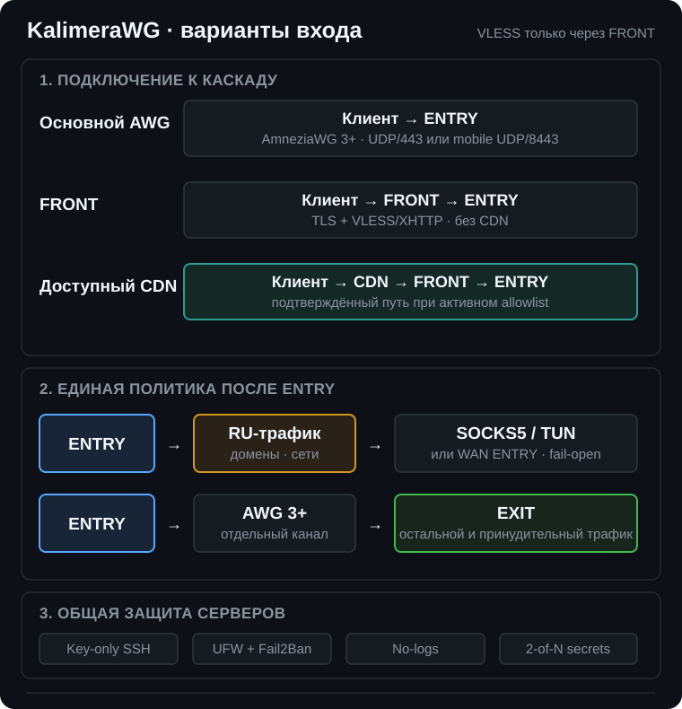

# FRONT: управляемый вход VLESS/XHTTP

## Статус тестовой ветки

Ветка `codex/front-release-packages-4-8` продолжает проверенную реализацию
пакетов 1-4 и доводит FRONT до управляемого эксплуатационного контура:

| Пакет | Что реализовано |
|---|---|
| 1. Модель и миграция | единые параметры `front_enabled`, `front_access_modes`, `front_cdn_state`; автоматическая миграция прежнего inventory |
| 2. Общий deploy | FRONT можно выбрать при чистой установке или добавить через `--enable-front`; мастер заранее показывает наличие FRONT и готовность CDN |
| 3. Защита FRONT | пользователь `kalimera`, key-only SSH, UFW, Fail2Ban, no-logs, Shamir 2-of-N, systemd credentials, аудит и контроль целостности |
| 4. Отдельный backend | VLESS на ENTRY вынесен из RU sing-box в `kalimera-front-backend.service`; прямого пользовательского VLESS на ENTRY нет |
| 5. Пользователи | `vless-user` создаёт, показывает, экспортирует и отзывает отдельные UUID; JSON выводится только по явной команде |
| 6. Замена FRONT | двухфазные prepare, commit и rollback сохраняют старый FRONT до проверки нового |
| 7. Диагностика | `kalimera-test`, health и terminal status проверяют роль сервера, TLS endpoint и согласованность реестра пользователей |
| 8. Приёмка | реальные проверки Xray, Nginx, JSON-экспорта, миграции и неизменности allowlist-транспорта входят в validate |

Подписки отсутствуют. Клиент получает отдельный JSON для direct или CDN,
который выводится после создания и повторно доступен только через явный экспорт.

Каждый управляемый FRONT по умолчанию использует два согласованных уровня:

| Уровень | Сервер | Клиент |
|---|---|---|
| TLS | сертификат origin или CDN | `security: tls`, SNI и ALPN |
| VLESS Encryption | ML-KEM-768 `decryption` | парное значение `encryption` в полном JSON |

Значения VLESS Encryption генерируются Xray одной парой и не должны
переноситься между разными FRONT вручную. Deploy проверяет, что оба файла пары
существуют, клиентский JSON содержит ML-KEM-768 и обе конфигурации принимаются
закреплённым Xray-core.

## Архитектура

<p align="center">
  <picture>
    <source media="(max-width: 600px)" srcset="../assets/whitelist-cascade-ru-mobile.svg">
    
  </picture>
</p>

| Путь | Транспорт | Назначение |
|---|---|---|
| клиент → ENTRY | AmneziaWG, UDP/443 или UDP/8443 | основной путь с минимальными накладными расходами |
| клиент → FRONT | TLS + VLESS/XHTTP, TCP/443 | прямой режим без CDN |
| клиент → CDN → FRONT | TLS + VLESS/XHTTP, TCP/443 | дополнительный вход через заранее подготовленный CDN |
| FRONT → ENTRY | VLESS+REALITY, TCP | служебный зашифрованный хоп, разрешённый UFW только от FRONT |
| ENTRY → EXIT | AWG 3+ | основной и `se-domain` маршрут |
| ENTRY → RU | SOCKS5/TUN либо fail-open через WAN ENTRY | российские домены и сети |

Прямого пользовательского VLESS-inbound на ENTRY в новой модели нет. Публичный
TCP-порт backend слушает отдельная служба, но UFW принимает соединения только
от закреплённого IPv4 FRONT. Пользователь подключается к FRONT независимо от
того, используется CDN или origin-домен FRONT напрямую.

## Независимость от RU-прокси

| Служба ENTRY | Назначение | Что происходит при `ru-proxy off` |
|---|---|---|
| `sing-box.service` | SOCKS5/TUN и RU DoH | останавливается либо работает в соответствии с режимом RU-прокси |
| `kalimera-front-backend.service` | служебный VLESS+REALITY от FRONT | продолжает работать |
| `awg-entry-routing.service` | таблицы и packet marks | сохраняет основной EXIT-маршрут и fail-open RU |

Backend классифицирует `ru-domain`, `.ru`, `.рф`, российские сети и
`se-domain` по тем же источникам, что AWG-клиенты. Метка `0x1` направляет
обычный трафик через EXIT. Метка `0x2` использует RU TUN, когда он активен, и
штатно выходит через WAN ENTRY при fail-open.

## Режимы FRONT

| `front_access_modes` | Требования | Клиентский адрес |
|---|---|---|
| `[direct]` | A-запись origin-домена на FRONT и сертификат Certbot | origin-домен FRONT |
| `[cdn]` | готовый CDN, проверяемый DNS и TLS | публичный домен CDN |
| `[direct, cdn]` | выполнены оба набора требований | отдельные профили для origin и CDN |

`front_cdn_state: ready` разрешается только после явного подтверждения в
мастере. Deploy дополнительно проверяет разрешение имени и TLS готового
CDN-ресурса. Если CDN ещё не создан, выбирается `direct`; незавершённая
конфигурация не применяется молча.

## Чистая установка

Запустите обычный `./deploy`. На этапе серверов мастер спросит, нужен ли
FRONT, а затем запросит:

1. адрес и текущий SSH-доступ к чистой VPS FRONT;
2. новый управляемый SSH-порт;
3. origin-домен с готовой A-записью;
4. e-mail Certbot;
5. режим `direct`, `cdn` или оба;
6. домен CDN, только если ресурс уже готов;
7. подходящий TLS 1.3 dest для внутреннего REALITY.

До начала изменений и перед запуском Ansible выводится отдельная сводка:

```text
FRONT: включён или отключён
Режимы: direct, cdn или оба
CDN: не используется или готов
VLESS: только через FRONT
```

FRONT входит в тот же транзакционный deploy, проверку SSH-перехода,
runtime-secrets и итоговый аудит, что ENTRY и EXIT.

## Добавление к существующему каскаду

```bash
cd /root/KalimeraWG
./deploy --resume --enable-front
```

Команда добавляет группу `front`, включает отдельный backend на ENTRY,
отключает прямой пользовательский VLESS на ENTRY и применяет все три роли в
одном прогоне. Старые переменные экспериментального FRONT мигрируют в новую
модель автоматически.

## Управление VLESS-пользователями

Команды выполняются на FRONT под пользователем `kalimera` без написания
`sudo`:

```bash
vless-user list
vless-user create phone cdn
vless-user create laptop direct
vless-user export phone
vless-user delete laptop --yes
```

После `create` полный JSON сразу выводится на экран. Кроме того, временная копия
с правами `0600` сохраняется в `/run/kalimera-vless-exports/ИМЯ.json`, а команда
печатает готовую строку `nano /run/kalimera-vless-exports/ИМЯ.json`. Каталог
находится в RAM и очищается при перезагрузке; `vless-user export ИМЯ` повторно
создаёт файл. Реестр UUID, параметры
XHTTP и базовая конфигурация Xray находятся в зашифрованном runtime-хранилище.
Изменение применяется атомарно: кандидат проверяется настоящим бинарником
Xray, затем служба перезапускается и пакет секретов перепаковывается. При
ошибке возвращаются прежний реестр и прежняя конфигурация.

Команда изменяет только массив `clients` VLESS-inbound. Подтверждённые
параметры CDN/XHTTP, TLS, Nginx и FRONT-ENTRY не пересчитываются.

Для сохранения JSON сразу на компьютере администратора выполните локально:

```bash
ssh -p ПОРТ kalimera@FRONT \
  'sudo -n /usr/local/libexec/kalimera-admin-command vless-user export phone' \
  > phone.json
```

Временный JSON на FRONT при этом также обновляется в
`/run/kalimera-vless-exports`. Он не публикуется через HTTP, хранится только
в RAM и удаляется при перезагрузке.

## Безопасная замена FRONT

Замена выполняется с управляющего ENTRY в два этапа:

```bash
kalimera-deploy --resume --replace-front
```

На prepare установщик:

1. считывает реестр пользователей со старого FRONT без записи в журнал;
2. сохраняет зашифрованную копию в Ansible Vault;
3. поднимает новый FRONT с новым origin-доменом;
4. сохраняет прежний IP в точном временном правиле UFW ENTRY;
5. не меняет CDN-домен, XHTTP path, UUID и backend ENTRY.

Поскольку direct-режим использует origin-домен самого FRONT, после prepare
каждый direct-пользователь должен получить обновлённый JSON с нового сервера:

```bash
vless-user export ИМЯ
```

UUID сохраняется, но старый JSON продолжает обращаться к прежнему origin-домену.
CDN-пользователей это не затрагивает: их клиентский домен и XHTTP path не
изменяются.

После проверки новой direct-сессии и переключения CDN origin:

```bash
kalimera-deploy --resume --commit-front-replacement
```

Commit повторно проверяет весь каскад и только затем удаляет временный доступ
старого FRONT. До commit можно вернуть прежний inventory:

```bash
kalimera-deploy --resume --rollback-front-replacement
```

После успешного commit старый FRONT автоматически исключается из UFW ENTRY, но
не выключается и не очищается удалённо. После контрольной проверки нового FRONT
старую VPS необходимо выключить или переустановить. Это действие намеренно не
автоматизировано, чтобы установщик не выполнял необратимые операции на сервере.

Если старый FRONT полностью недоступен, его актуальный реестр пользователей
нельзя безопасно извлечь. В этом случае создаются новые пользовательские UUID
и клиентские JSON.

## Граница ручной настройки CDN

KalimeraWG не создаёт учётную запись и ресурс у внешнего CDN-провайдера. До
выбора режима `cdn` оператор должен подготовить:

| Параметр CDN | Требуемое значение |
|---|---|
| origin | HTTPS origin-домен FRONT |
| клиентский домен | отдельный домен с действительным сертификатом CDN |
| методы | GET для `packet-up`; POST, PUT, PATCH и DELETE не нужны (на Yandex Cloud CDN они выключены по умолчанию); при другом XHTTP mode также требуемые POST |
| тело запроса | не используется: каждый пакет аплинка - GET без тела. Yandex Cloud CDN отвечает `413 Payload Too Large` на любой GET, HEAD или OPTIONS с телом |
| заголовки запроса | CDN передаёт origin без изменений произвольные заголовки `X-...`: два заголовка до 3000 символов в одном запросе, около 6,1 КБ всех заголовков вместе с cookie и заголовками браузера |
| кэширование | выключено для случайного `front_xhttp_path` |
| buffering | выключено для долгоживущего XHTTP-потока |
| таймаут origin | достаточно большой для длительной сессии |

Доступность конкретного CDN edge зависит от внешней сетевой политики и не
может гарантироваться проектом.

### Аплинк через CDN: GET без тела

В режиме `packet-up` каждый пакет аплинка - отдельный HTTP-запрос с методом
GET. Yandex Cloud CDN отвечает `413 Payload Too Large` на любой GET, HEAD или
OPTIONS с телом. Причина в самом наличии тела, а не в его размере, так
указано в документации CDN с выпуска от 30.09.2026. Поэтому клиентский
профиль не кладёт нагрузку в тело. Xray-core кодирует пакет в base64url и
передаёт его в заголовках `X-Client-State-0`, `X-Client-State-1` и так далее.
Параметры задаются переменными `front_xhttp_uplink_*` в
`roles/front/defaults/main.yml`:

| Переменная | Значение | Смысл |
|---|---|---|
| `front_xhttp_uplink_data_placement` | `header` | нагрузка в заголовках; `cookie` допустимо, `body` запрещено |
| `front_xhttp_uplink_data_key` | `X-Client-State` | имя заголовков: только латиница, цифры и дефис, потому что nginx молча выбрасывает имена с подчёркиванием |
| `front_xhttp_uplink_chunk_size` | `2800-3000` | длина одного заголовка в символах; через CDN проверен одиночный заголовок 6000 байт |
| `front_xhttp_uplink_max_each_post_bytes` | `4096` | наибольший пакет на один запрос: ровно два заголовка; до 8212 байт больше ничего не даёт |
| `front_xhttp_uplink_min_posts_interval_ms` | `8-12` | интервал между запросами; потолок аплинка около 2,2 Мбит/с (измерено: 273 КБ/с) |

Потолок аплинка ниже, чем 4096 байт за 10 мс: VLESS Encryption пишет данные
записями по 8213 байт, Xray-core отправляет каждую тремя запросами (4096,
4096 и 21 байт), и на 8192 байта данных уходит три интервала. Поднять
потолок можно более коротким интервалом (больше запросов в секунду через
CDN) или пакетом от 8213 байт, но второе требует около 11 КБ заголовков на
запрос и допустимо только после живой проверки такого размера через CDN;
подробности - в комментариях `roles/front/defaults/main.yml`.
| `front_xhttp_server_max_header_bytes` | `16384` | предел заголовков HTTP-сервера Xray за nginx |

Сервер FRONT принимает аплинк в режиме `auto`: из заголовков, cookie и тела
сразу. Ключ на сервере и в клиентском профиле обязан совпадать. Прямой путь
через nginx FRONT принимает и старые JSON с телом, а через CDN такие JSON
больше не работают.

`awg-health --strict` на FRONT с режимом `cdn` проверяет весь путь вживую.
Он отправляет через домен CDN запрос в форме пакета аплинка: GET без тела,
с cookie, query и заголовками браузера, как у клиента. Проба не меньше
любого настоящего пакета: наибольшие длина куска и паддинг, а нагрузка на
48 байт больше `front_xhttp_uplink_max_each_post_bytes`. Проверка проходит,
если Xray ответил 200. Затем уходит такой же запрос, в котором испорчен
последний символ нагрузки: Xray обязан ответить 400. Если CDN или nginx
выбросили или обрезали любой из заголовков `X-Client-State-N`, испорченный
символ до Xray не доходит, ответ будет 200, и проверка падает. URL и cookie
в вывод и в аргументы процессов не попадают.

Пока замена FRONT подготовлена (`--replace-front`) и не подтверждена, CDN
origin ещё указывает на прежний FRONT, и проба через CDN проверила бы не тот
сервер. В этом состоянии тот же пакет уходит напрямую на origin-домен нового
FRONT: проверяются его nginx и Xray, но не CDN. Проба через CDN включается
при первом обычном `kalimera-deploy --resume` после
`--commit-front-replacement`.

После обновления FRONT каждый VLESS-пользователь должен получить новый JSON.
Старые профили `Kalimera-FRONT-disguiseV2` через CDN получают `413`. Новые
профили называются `Kalimera-FRONT-disguiseV3`:

```bash
vless-user list
vless-user export ИМЯ
```

Повторите `export` для каждого имени из списка и импортируйте JSON в клиент
заново. UUID и XHTTP path не меняются.

## Защита FRONT

FRONT получает общую политику серверов проекта:

| Контроль | Реализация |
|---|---|
| SSH | только `kalimera` по ключу; root SSH отключён; строгая политика sshd |
| Firewall | SSH, TCP/80 для ACME и TCP/443; неожиданные listener проверяются |
| Блокировки | строгий jail Fail2Ban с volatile state |
| No-logs | journal только в RAM; UFW, Nginx и Xray не сохраняют активность; coredump и history отключены |
| Секреты | конфигурация Xray и закрытый TLS-ключ Certbot зашифрованы на диске; открываются в `/run`, Xray получает конфигурацию через systemd credentials |
| Кворум | FRONT получает отдельную Shamir-долю и участвует в схеме 2-of-N |
| Целостность | управляемые файлы входят в локальный манифест контрольных сумм |
| Диагностика | `kalimera-test`, `awg-health --strict`, `server-audit` учитывают роль FRONT |

## Проверка

На каждом сервере под `kalimera`:

```bash
kalimera-test
```

На FRONT дополнительно:

```bash
systemctl is-active nginx xray
nginx -t
server-audit
```

На ENTRY:

```bash
systemctl is-active kalimera-front-backend
reality-dest-switch status
ru-proxy off
kalimera-test
ru-proxy on
kalimera-test
```

Отключение RU-прокси не должно останавливать `kalimera-front-backend` и не
должно разрывать основной маршрут VLESS через EXIT.

## Ограничения текущего этапа

| Возможность | Статус |
|---|---|
| управление несколькими VLESS-пользователями | реализовано командой `vless-user` |
| экспорт защищённого JSON пользователя | реализовано без публичной ссылки |
| HTTP-подписка | намеренно отключена |
| безопасная замена FRONT | реализована в два этапа с rollback |
| несколько FRONT/CDN и балансировка | не реализовано |
| гарантия работы любого CDN у любого оператора | невозможна |
